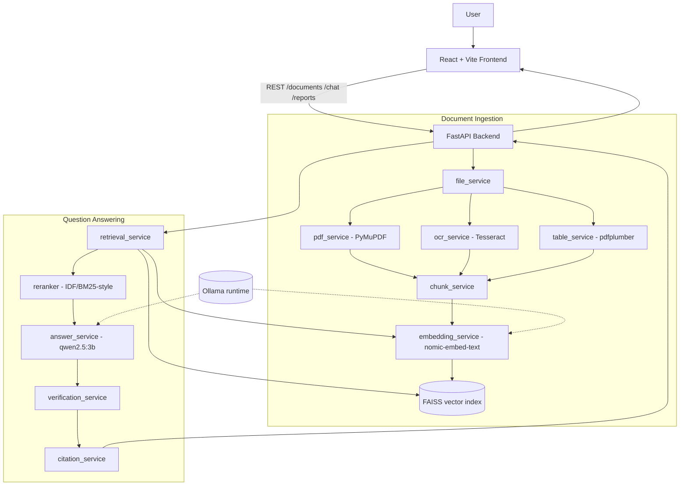

# Retrieval-Augmented Vision AI Assistant for Image Analytics

**DocuLens** — a local, Retrieval-Augmented Generation (RAG) question-answering
assistant for PDF and image documents, with OCR-based text extraction, page-level
citations, and a strict hallucination-prevention (refusal) mechanism.

> Academic context: B.Tech (AIML / Deep Learning) mini-project. The system uses
> **pretrained models served locally through Ollama** — it does **not** train any
> model from scratch, and it does **not** perform object detection or
> real-time video/vision understanding. "Image analytics" here means turning
> document images and scanned pages into machine-readable text (OCR) and then
> reasoning over that text.

---

## Abstract

Organizations and students accumulate large numbers of PDFs and scanned images,
but finding a specific fact inside them is slow and manual. DocuLens is a
lightweight, fully local document question-answering system. A user uploads PDFs
or images; the backend extracts text (PyMuPDF for native PDFs, Tesseract OCR for
scanned pages and images, pdfplumber for tables), splits it into chunks, and
embeds each chunk with a pretrained embedding model. Embeddings are stored in a
FAISS vector index. When a question is asked, the system retrieves the most
relevant chunks, reranks them, builds a grounded prompt, and asks a small local
language model to answer **only from the retrieved evidence**. Every answer is
verified against the evidence and returned with page-level citations. If the
evidence is insufficient, the system refuses to answer instead of guessing. The
whole pipeline runs offline on commodity hardware using Ollama
(`nomic-embed-text` + `qwen2.5:3b`), FAISS, and Tesseract.

---

## Problem Statement

General-purpose chatbots answer document questions from **parametric memory**,
which leads to hallucinated facts, invented numbers, and citations that do not
exist. Cloud document-AI services raise privacy, cost, and connectivity
concerns. There is a need for a **small, local, auditable** assistant that:

- reads text-based and scanned/image documents,
- answers strictly from the uploaded content,
- cites the exact page for every claim,
- and explicitly refuses when the documents do not support an answer.

---

## Objectives

1. Build a local RAG pipeline over PDFs and images with no cloud dependency.
2. Extract text from native PDFs, scanned pages, and images using OCR, and
   detect simple tables.
3. Retrieve relevant passages with dense vector search (FAISS) and improve
   ranking with a lightweight reranking stage.
4. Generate grounded answers with a small local LLM and attach page-level
   citations.
5. Prevent hallucination through a strict system prompt, evidence gating, and
   numeric verification, with a fixed refusal sentence when evidence is lacking.
6. Support multiple documents with per-document isolation and comparison.
7. Provide a lightweight, reproducible evaluation harness with realistic metrics.

---

## Why Deep Learning?

Classic keyword search (TF-IDF / BM25) fails on paraphrase: a question phrased
differently from the document text returns poor matches. Deep **embedding
models** map both the question and the passages into a shared semantic vector
space, so retrieval works on meaning rather than exact words. A deep **language
model** is then needed to compose a fluent, faithful answer from the retrieved
evidence. DocuLens therefore uses two pretrained deep models — one for semantic
retrieval and one for generation — while keeping the rest of the system
(retrieval index, reranking, verification) lightweight and interpretable. No
model is trained in this project; both are used off-the-shelf via Ollama.

---

## System Architecture



---

## Workflow / Pipeline

1. **Upload** — the user uploads a PDF/PNG/JPG; the file is validated and stored.
2. **Extraction** — PyMuPDF reads native text page by page; pages with little or
   no text are sent to Tesseract OCR; pdfplumber extracts simple tables.
3. **Chunking** — page text is cleaned (repeated running headers/footers are
   suppressed) and split into sections; tables become their own sections.
4. **Embedding & indexing** — each section is embedded with `nomic-embed-text`
   and stored in a FAISS `IndexFlatIP` index (vectors are L2-normalized, so inner
   product equals cosine similarity) with a JSON metadata sidecar.
5. **Retrieval** — the question is embedded and the index is searched; results
   below a minimum similarity score are discarded (this preserves document
   isolation and the refusal behavior).
6. **Reranking** — surviving candidates are reordered by a hybrid dense +
   IDF-weighted lexical score so fact-bearing chunks rise above name/header noise.
7. **Answer generation** — the top chunks form a bounded evidence context; a
   strict system prompt forces the model to answer only from that evidence.
8. **Verification & citation** — the draft is checked (numbers must appear in the
   evidence) and page-level sources are attached; otherwise the refusal sentence
   is returned.

---

## Technologies Used

| Layer | Technology | Purpose |
|-------|-----------|---------|
| Frontend | React + Vite | Upload UI, chat, citations, reports |
| Backend | FastAPI + Uvicorn | REST API and background processing |
| PDF text | PyMuPDF (fitz) | Native text and page extraction |
| OCR | Tesseract (pytesseract) | Text from images and scanned pages |
| Tables | pdfplumber | Simple table extraction |
| Embeddings | Ollama `nomic-embed-text` | Semantic vectors for retrieval |
| Generation | Ollama `qwen2.5:3b` | Grounded answer generation |
| Vector search | FAISS | Local similarity index |
| Storage | Local files + JSON registry | Documents, processed content, index |

---

## Deep Learning Components

DocuLens uses **only pretrained models**, served locally by Ollama. Nothing is
trained from scratch in this project.

- **`nomic-embed-text` (embedding model)** — a transformer text-embedding model
  that converts questions and passages into dense vectors for semantic retrieval.
- **`qwen2.5:3b` (language model)** — a small decoder-only transformer used to
  generate the final answer, constrained by a strict grounding prompt.

Both models run offline on CPU-class hardware. Their quality bounds the system's
accuracy: a small local model has limited reasoning, and retrieval quality
depends on the embedding model.

---

## RAG Pipeline

Retrieval-Augmented Generation combines a retriever with a generator:

- **Retriever** — dense cosine search over the FAISS index, followed by a
  minimum-score gate (`min_retrieval_score`) and a **model-free reranker**
  (IDF-weighted BM25-style scoring with no length normalization, blended with the
  dense score). No extra/cross-encoder model is added, keeping the stack local.
- **Context builder** — formats the top-K chunks (default `top_k = 6`) into
  numbered evidence blocks within a character budget, de-duplicating repeats.
- **Generator** — `qwen2.5:3b` answers under a 16-rule system prompt that
  forbids outside knowledge and invention.
- **Verifier/Citer** — validates numeric claims against the evidence and builds
  at most two page-level sources.

---

## Image Analytics Pipeline (OCR + Document Understanding)

For images and scanned PDFs, "analytics" means **document understanding via
OCR**, not object detection:

1. Each image/scanned page is rendered and passed to **Tesseract OCR**.
2. OCR output is treated as page text, flagged as OCR-derived, and flows through
   the same chunk → embed → retrieve → answer pipeline as native text.
3. Answers that rely on OCR evidence are marked so the user knows the source was
   a scan (OCR can introduce character errors).

There is **no** CNN, YOLO, COCO, or ImageNet component; the system does not
detect objects or perform real-time vision understanding.

---

## Evaluation Dataset

A lightweight evaluation set lives in `evaluation/`:

```
evaluation/
├── documents/          sample_report.pdf, sample_invoice.png, product_catalog.pdf
├── questions.json      15 labelled questions
├── evaluate.py         runs the real pipeline and scores it
└── results/            evaluation_results.csv / .json (generated)
```

The 15 questions cover: direct factual, table-based, OCR/image text, multi-page,
multi-document isolation, citation/page verification, and **unanswerable**
questions (`answerable: false`) that must be refused. Each question records
`question`, `expected_answer`, `expected_page`, `answerable`, and `document`.

---

## Evaluation Metrics

`evaluate.py` runs the actual pipeline (embed → retrieve → rerank → answer →
verify → cite) against an **isolated data store** (`evaluation/.evaldata`, never
the app's real index) and reports:

- **Retrieval Recall@K** — fraction of answerable, page-labelled questions whose
  expected page appears in the top-K retrieved set.
- **Answer accuracy** — keyword/number overlap between the model answer and the
  expected answer (all expected numbers must be reproduced).
- **Citation / page accuracy** — fraction of answerable questions whose returned
  sources cite the expected document page.
- **Refusal accuracy** — fraction of unanswerable questions correctly refused.
- **Overall summary** plus a per-category breakdown.

Results are written to `evaluation/results/evaluation_results.csv` (per
question) and `evaluation_results.json` (per question + summary). The JSON
summary records the exact `chat_model` and `embedding_model` used, so the
checked-in numbers are traceable; re-run the script to regenerate them for the
models installed on your machine. Because the system uses a small local model and
depends on OCR quality, these numbers are a **realistic snapshot on a tiny sample
corpus**, not a guaranteed benchmark — a perfect score here reflects the small,
easy 3-document set, not general capability, and results will vary with a larger
or harder corpus.

---

## Hallucination Prevention & Refusal Mechanism

Multiple layers reduce hallucination:

1. **Evidence gating** — if no chunk clears the similarity threshold, the model
   is never called and the system refuses.
2. **Strict grounding prompt** — 16 rules forbid outside knowledge, invention of
   names/numbers/dates, and merging unrelated evidence.
3. **Numeric verification** — every multi-digit number in a draft answer must
   appear in the retrieved evidence (or match a cited page); otherwise the draft
   is rejected.
4. **Server-side citations** — sources are built only from retrieved sections, so
   page numbers and document names cannot be invented by the model.
5. **Fixed refusal sentence** — when evidence is insufficient the system replies
   exactly:

   > "I could not find enough information in the uploaded documents to answer
   > this confidently."

These mechanisms **reduce** hallucination; they do not claim to eliminate it.

---

## Limitations

- Uses a small local model (`qwen2.5:3b`) with limited reasoning; complex or
  multi-step inference may be weak.
- Verification currently checks **numeric** claims; names, dates, and other text
  are not independently verified.
- Answer quality on scans is bounded by **OCR accuracy**; poor scans degrade
  results.
- No true multimodal vision: images are understood only through extracted text.
- Table extraction is basic and may miss complex/merged-cell layouts.
- Single-user, local storage; not built for concurrency or production scale.
- The repository name mentions "vision", but there is no object-detection or
  image-classification model.

---

## Future Scope

- Wire magic-byte/content-type validation into uploads (the helper was removed as
  dead code; a real implementation can be added).
- Add a cross-encoder or hybrid sparse+dense retriever for harder queries.
- Extend verification beyond numbers to entities and dates.
- Support more document types (DOCX, multi-column layouts) and better table
  parsing.
- Optional larger local model toggle for higher-quality answers.
- A bigger, human-verified evaluation corpus and automated regression tracking.

---

## Installation & Usage

### Requirements

- Python 3.11+
- Node.js 20+
- Ollama running locally
- Models: `qwen2.5:3b` and `nomic-embed-text:latest`
- Tesseract OCR (for scanned documents):
  https://github.com/UB-Mannheim/tesseract/wiki

### 1. Start Ollama and pull models

```bash
ollama serve            # if not already running (on Windows it runs in the tray)
ollama pull qwen2.5:3b
ollama pull nomic-embed-text:latest
ollama list             # verify both models are present
```

### 2. Backend

```bash
cd backend
python -m venv .venv
.venv\Scripts\activate        # Windows
# source .venv/bin/activate   # macOS/Linux
pip install -r requirements.txt
copy .env.example .env        # Windows (cp on macOS/Linux)
uvicorn app.main:app --reload --port 8000
```

API: http://127.0.0.1:8000 — docs: http://127.0.0.1:8000/docs

### 3. Frontend

```bash
cd frontend
npm install
npm run dev
```

App: http://localhost:5173

### One-click start (Windows)

Double-click `start.bat`. It starts Ollama only if it is not already running
(Ollama normally runs as a background/tray app), then opens the backend and
frontend in two terminals.

### Run the tests

```bash
cd backend
.venv\Scripts\activate
pytest
```

### Run the evaluation

```bash
# from the repository root, using the backend virtual environment:
backend/.venv/Scripts/python.exe evaluation/evaluate.py     # Windows
# backend/.venv/bin/python evaluation/evaluate.py           # macOS/Linux
```

Ollama must be running. Results are written to `evaluation/results/`.

---

## Project Structure

```
doculens/
├── backend/
│   ├── app/
│   │   ├── api/            documents, chat, reports, health routers
│   │   ├── core/           config-agnostic errors, logging, security helpers
│   │   ├── models/         Pydantic schemas
│   │   ├── services/       file, pdf, ocr, table, chunk, embedding,
│   │   │                   vector_store, retrieval, answer, verification,
│   │   │                   citation, report, ollama
│   │   └── main.py         FastAPI app
│   ├── tests/              pytest suite
│   ├── requirements.txt
│   └── .env.example
├── frontend/
│   └── src/                React components, hooks, api client, styles
├── evaluation/
│   ├── documents/          sample corpus
│   ├── questions.json      labelled questions
│   ├── evaluate.py         evaluation harness
│   └── results/            generated metrics (CSV/JSON)
├── samples/                quick-test sample_report.pdf, sample_invoice.png
├── docs/                   PRD, Architecture, Design, Rules, Phases, Memory
│   └── archive/            PROJECT_WALKTHROUGH.md (long reference)
├── start.bat               one-click launcher (Windows)
└── README.md
```

---

## Conclusion

DocuLens demonstrates a complete, **local** Retrieval-Augmented Generation
system for document question answering over PDFs and images. It combines OCR and
table extraction, FAISS dense retrieval with a lightweight reranker, a small
pretrained language model, and multiple hallucination-prevention layers with
page-level citations and an explicit refusal mechanism. It is intentionally
lightweight and interpretable, suitable as a B.Tech AIML/Deep Learning project.
The system does not claim perfect accuracy or zero hallucination: its quality is
bounded by the small local models and by OCR quality, and it is best understood
as a privacy-preserving, auditable document assistant rather than a
general-purpose vision system.
